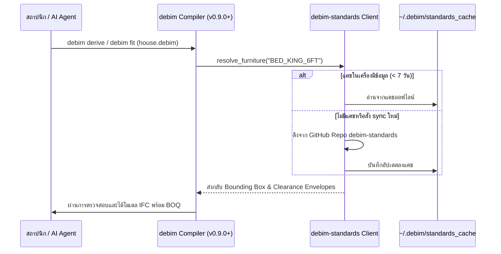

# 🏗️ Architecture & Schema Specification (debim-standards)

เอกสารฉบับนี้กำหนดมาตรฐานการจัดเก็บข้อมูล, รูปแบบของ Schema, กฎการตรวจสอบ (Validation Rules) และกระบวนการผสานข้อมูล (Integration Pipeline) ระหว่าง `debim-standards` และเอนจิน `debim`

---

## 1. ปรัชญาการออกแบบ (Design Philosophy)

1. **Human & Machine Readable:** ข้อมูลทุกชุดต้องเก็บในรูปแบบ **YAML** ที่มนุษย์อ่านเข้าใจง่าย และคอมไพเลอร์แปลงเป็น Machine Code (JSON Schema / Pydantic / Python Dict) ได้ทันที
2. **Defensive Validation:** ทุกขนาด (Dimensions) และระยะเผื่อ (Clearances) ต้องผ่านการรับรองความถูกต้องด้วย Pydantic Models:
   - ขนาดความกว้าง, ความลึก, ความสูง ต้องเป็นจำนวนบวก ($> 0.0$)
   - ระยะ Clearance หน้า, หลัง, ซ้าย, ขวา ต้อง $\ge 0.0$
   - ต้องระบุแหล่งอ้างอิงมาตรฐาน (Standard Reference) ทุกชิ้น (เช่น Neufert, Panero & Zelnik, กฎหมายอาคาร)
3. **Decoupled Lifecycle:** สามารถอัปเดตราคาวัสดุหรือปรับปรุงระยะเฟอร์นิเจอร์ได้ตลอดเวลาโดยไม่กระทบต่อ Core Engine ของ `debim`

---

## 2. โครงสร้าง Schema แต่ละหมวด

### 2.1 หมวด Human Scale & Furniture Clearance (`standards/human_scale/`)
```yaml
schema: "debim-standards/human-scale/v1.0"
category: "bedroom"
description: "มาตรฐานขนาดเฟอร์นิเจอร์ห้องนอนและระยะสัญจรใช้งาน"

items:
  BED_KING_6FT:
    id: "FUR-BED-KING-6FT"
    name: "เตียงนอนขนาด King Size (6 ฟุต)"
    name_en: "King Size Bed 6ft"
    category: "bedroom"
    reference: "Neufert 4th Edition, p. 254; Panero & Zelnik, p. 142"
    dimensions:
      width: 1.80
      depth: 2.00
      height: 0.90
    clearance:
      front: 0.80   # ทางเดินปลายเตียง
      left: 0.60    # ระยะลุกออกจากเตียงฝั่งซ้าย
      right: 0.60   # ระยะลุกออกจากเตียงฝั่งขวา
      back: 0.00    # หัวเตียงชิดผนัง
    footprint_area: 3.60
    total_space_area: 7.28
    tags: ["bedroom", "sleeping", "residential"]
```

### 2.2 หมวดกฎหมายอาคารและการตรวจสอบ (`standards/regulations/`)
```yaml
schema: "debim-standards/regulations/v1.0"
jurisdiction: "TH"
name: "กฎกระทรวง ฉบับที่ 55 (พ.ศ. 2543)"
law_reference: "ออกตามความในพระราชบัญญัติควบคุมอาคาร พ.ศ. 2522"

clauses:
  CLAUSE_51_VENTILATION:
    code: "TH-MR55-C51"
    title: "พื้นที่ช่องเปิดรับแสงธรรมชาติและการระบายอากาศ"
    target_elements: ["IfcSpace"]
    space_types: ["LIVING", "BEDROOM", "OFFICE"]
    rule:
      type: "MINIMUM_RATIO"
      metric: "natural_ventilation_ratio"
      threshold: 0.10   # ไม่น้อยกว่า 10% ของพื้นที่ห้อง
      formula: "window_area / net_floor_area >= 0.10"
    severity: "ERROR"
    remediation_action: "ADD_WINDOW"

  CLAUSE_BATHROOM_DROP:
    code: "TH-MR55-BATH-DROP"
    title: "ระดับพื้นห้องน้ำและสุขาภิบาล"
    target_elements: ["IfcSpace"]
    space_types: ["BATHROOM", "RESTROOM"]
    rule:
      type: "MAXIMUM_ELEVATION"
      metric: "drop_elevation"
      threshold: -0.10  # ต้องลดระดับไม่น้อยกว่า 10 ซม. (-0.10m)
    severity: "ERROR"
    remediation_action: "APPLY_WET_DROP"
```

### 2.3 หมวดวัสดุและราคากลาง ว480 (`standards/materials/`)
```yaml
schema: "debim-standards/materials/v1.0"
authority: "Comptroller General's Department (กรมบัญชีกลาง)"
standard_ref: "ว480"

materials:
  MAT-CONC-240:
    id: "MAT-CONC-240"
    name: "คอนกรีตผสมเสร็จ รูปลูกบาศก์ 240 ksc"
    category: "concrete"
    unit: "CUBIC_METER"
    density_kg_m3: 2400.0
    embodied_carbon_kg_co2e: 310.0
    cost_base:
      material_price: 1950.00
      labor_price: 350.00
      total_unit_price: 2300.00
      currency: "THB"
```

---

## 3. ตัวประสานข้อมูลเข้า debim Core (Integration Flow)


