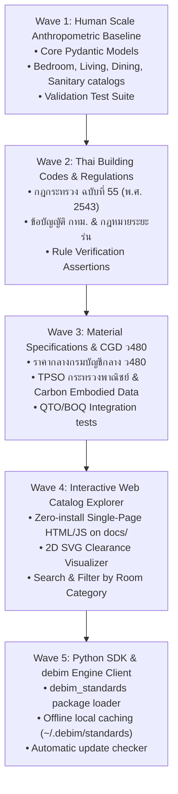

# 🗺️ Master Roadmap (debim-standards v0.1.0)

แผนการดำเนินงานและการแบ่งงวดการพัฒนาสำหรับระบบ **debim-standards** เพื่อส่งมอบข้อมูลสถาปัตยกรรมเปิด, ชุดทดสอบ และระบบเว็บเอกสารอินเตอร์แอคทีฟ

---

## 🌊 สรุปภาพรวม 5 Waves

---

### Wave 1: Human Scale Anthropometric Baseline & Core Models
* **เป้าหมาย:** สร้าง Pydantic Schema และแค็ตตาล็อกขนาดเฟอร์นิเจอร์มาตรฐานพร้อม Clearance จาก Neufert & Panero
* **ไฟล์หลัก:**
  - `src/debim_standards/models.py`
  - `standards/human_scale/bedroom.yaml`
  - `standards/human_scale/living.yaml`
  - `standards/human_scale/dining.yaml`
  - `standards/human_scale/sanitary.yaml`
  - `standards/human_scale/circulation.yaml`
  - `tests/test_human_scale.py`
* **เกณฑ์การยอมรับ (Acceptance Criteria):**
  - มีเฟอร์นิเจอร์มาตรฐานครบทุกหมวดพื้นฐานอย่างน้อย 20 รายการ
  - ทุกรายการมีมิติ กว้าง, ลึก, สูง และระยะ Clearance หน้า-หลัง-ซ้าย-ขวา
  - `pytest tests/test_human_scale.py` ผ่าน 100%

---

### Wave 2: Thai Building Codes & Legal Ruleset Catalog
* **เป้าหมาย:** สกัดข้อกำหนดกฎหมายควบคุมอาคารไทยให้เป็น Machine-Readable YAML สำหรับให้ debim audit นำไปใช้
* **ไฟล์หลัก:**
  - `standards/regulations/th/ministerial_reg_55.yaml` (แสง-ลม $\ge 10\%$, บันไดลูกตั้ง $\le 0.20$ ม. ลูกนอน $\ge 0.22$ ม., ความสูงห้อง $\ge 2.60$ ม.)
  - `standards/regulations/th/setbacks.yaml` (ระยะร่นอาคาร 0.50 ม. / 2.00 ม.)
  - `tests/test_regulations.py`
* **เกณฑ์การยอมรับ:**
  - แปลงข้อกำหนดกฎกระทรวง 55 ออกมาเป็นโครงสร้าง Rule ชัดเจน
  - มีข้อความแนะนำการแก้ไข (Remediation Advice) ภาษาไทยและอังกฤษ
  - `pytest tests/test_regulations.py` ผ่าน 100%

---

### Wave 3: Material Specifications & CGD ว480 Price Catalog
* **เป้าหมาย:** สเปกวัสดุก่อสร้างมาตรฐาน, ค่าความหนาแน่น, ค่า Embodied Carbon, และราคากลาง ว480
* **ไฟล์หลัก:**
  - `standards/materials/cgd_v480.yaml` (คอนกรีต, เหล็กเสริม, แบบหล่อ, อิฐ, กระเบื้อง, ประตู, หน้าต่าง)
  - `standards/materials/sustainability.yaml` (ค่า $kgCO_2e$ ต่อหน่วยวัสดุ)
  - `tests/test_materials.py`
* **เกณฑ์การยอมรับ:**
  - ครอบคลุมวัสดุหลักของอาคารพักอาศัยครบ 100%
  - แยกค่าวัสดุและค่าแรงตามเกณฑ์กรมบัญชีกลาง
  - `pytest tests/test_materials.py` ผ่าน 100%

---

### Wave 4: Interactive Web Catalog Explorer (docs/index.html)
* **เป้าหมาย:** หน้าเว็บสำหรับสถาปนิกและสาธารณะเปิดดูขนาดเฟอร์นิเจอร์ ระยะ Clearance และกฎหมายได้บนเบราว์เซอร์
* **ไฟล์หลัก:**
  - `docs/index.html` (Single-Page Application สไตล์มินิมอล)
  - `docs/app.js` (ตัวเรนเดอร์ 2D Dynamic Canvas / SVG แสดงผังเตียง โต๊ะ ตู้ และพื้นที่ Clearance สีโปร่งแสง)
  - `docs/data.json` (รวมแค็ตตาล็อกทุกตัวเป็นไฟล์เดียวสำหรับเว็บ)
* **เกณฑ์การยอมรับ:**
  - เปิดดูผ่านเบราว์เซอร์หรือ GitHub Pages ได้โดยไม่ต้องลงโปรแกรม
  - มีช่อง Search ค้นหาชื่อเฟอร์นิเจอร์ และเลือกหมวดหมู่ห้องได้
  - แสดงภาพไดอะแกรม 2D Top-View ของชิ้นงานพร้อมระยะ Clearance ชัดเจน

---

### Wave 5: Python SDK Client & debim Integration
* **เป้าหมาย:** พัฒนาตัวเชื่อมต่อสำหรับให้ `debim` ดึงข้อมูลไปใช้ พร้อมแคชออฟไลน์ในเครื่อง
* **ไฟล์หลัก:**
  - `src/debim_standards/loader.py`
  - `src/debim_standards/cache.py`
  - `tests/test_sdk_integration.py`
* **เกณฑ์การยอมรับ:**
  - `pip install -e .` แล้วเรียกใช้ `from debim_standards import get_furniture, get_regulation` ได้ทันที
  - สามารถทำงานได้ 100% แม้ไม่มีอินเทอร์เน็ต (ผ่าน Offline Local Snapshot)
